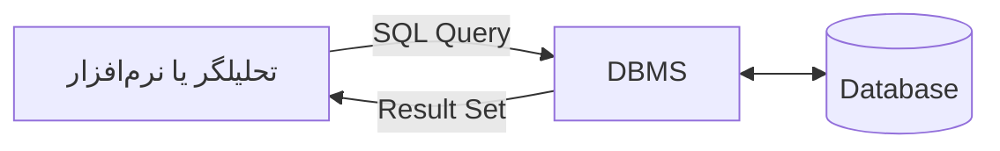

# درس ۱ — Database، DBMS و مدل‌های ذخیره‌سازی داده

## در این درس چه یاد می‌گیریم؟

پس از مطالعه این درس می‌توانید تفاوت میان **Data، Information، Database، DBMS و SQL** را توضیح دهید، ساختار پایه یک پایگاه داده رابطه‌ای را بشناسید و بدانید NoSQL در چه موقعیت‌هایی مطرح می‌شود.

## ۱. از داده خام تا اطلاعات قابل استفاده

فرض کنید خروجی یک سامانه ثبت سفارش را به این شکل دریافت کرده‌ایم:

```text
1404/02/10, 1042, 3, 275000
1404/02/10, 1043, 1, 890000
1404/02/11, 1042, 2, 275000
```

این مقادیر به‌تنهایی چندان گویا نیستند. هنوز مشخص نیست ستون‌ها چه معنایی دارند یا عددها به کدام محصول و سفارش اشاره می‌کنند.

وقتی برای داده‌ها ساختار و معنا تعیین کنیم، مثلاً:

| تاریخ سفارش | شناسه محصول | تعداد | مبلغ واحد |
|---|---:|---:|---:|
| ۱۴۰۴/۰۲/۱۰ | 1042 | 3 | 275,000 |
| ۱۴۰۴/۰۲/۱۰ | 1043 | 1 | 890,000 |
| ۱۴۰۴/۰۲/۱۱ | 1042 | 2 | 275,000 |

حالا می‌توانیم سؤال‌های مشخصی بپرسیم: چه تعداد از محصول 1042 فروخته شده؟ فروش روزانه چقدر بوده؟ کدام محصول درآمد بیشتری داشته است؟

**داده (Data)** مقادیر ثبت‌شده درباره یک رویداد یا موجودیت است. **اطلاعات (Information)** زمانی شکل می‌گیرد که داده‌ها در یک زمینه مشخص سازمان‌دهی، تفسیر یا پردازش شوند و برای پاسخ‌گویی به یک سؤال معنا پیدا کنند.

> نکته: داده خام الزاماً بی‌معنا نیست؛ اما بدون زمینه، تعریف ستون‌ها و قواعد تفسیر، ممکن است استفاده از آن دشوار یا حتی گمراه‌کننده باشد.

## ۲. پایگاه داده (Database) چیست؟

پایگاه داده مجموعه‌ای سازمان‌یافته از داده‌هاست که به شکلی نگهداری می‌شود تا بتوان آن را جست‌وجو، اضافه، اصلاح، حذف و تحلیل کرد.

برای مثال، یک فروشگاه آنلاین ممکن است داده‌های مربوط به این موجودیت‌ها را نگهداری کند:

- مشتریان و مشخصات تماس آن‌ها
- محصولات و قیمت‌ها
- سفارش‌ها و زمان ثبت آن‌ها
- اقلام هر سفارش و تعداد خرید

این اطلاعات معمولاً در چند جدول مرتبط نگهداری می‌شوند تا داده‌های تکراری کاهش پیدا کنند و هر نوع اطلاعات در محل مناسب خود قرار بگیرد.

## ۳. اجزای یک جدول رابطه‌ای

در پایگاه داده رابطه‌ای، داده‌ها معمولاً در قالب جدول ذخیره می‌شوند.

| اصطلاح | معنی | نمونه |
|---|---|---|
| Table | مجموعه‌ای از رکوردهای هم‌ساختار | customers |
| Row / Record | یک نمونه از موجودیت | یک مشتری |
| Column / Field | یک ویژگی از موجودیت | city |
| Primary Key | شناسه یکتای هر رکورد | customer_id |
| Foreign Key | ارجاع به رکورد جدول دیگر | customer_id در orders |

یک نمونه ساده از جدول مشتریان:

| customer_id | full_name | city |
|---:|---|---|
| 1 | نیلوفر احمدی | اصفهان |
| 2 | آرمان رضایی | شیراز |
| 3 | سارا محمدی | اصفهان |

هر سطر یک مشتری است و هر ستون یکی از ویژگی‌های او را نشان می‌دهد. در ادامه دوره، با قواعد طراحی این جدول‌ها و نحوه اتصال آن‌ها بیشتر آشنا می‌شویم.

## ۴. DBMS چیست و چه کاری انجام می‌دهد؟

**DBMS** مخفف Database Management System و به معنی «سیستم مدیریت پایگاه داده» است.

Database خودِ داده‌های سازمان‌یافته است؛ اما DBMS نرم‌افزاری است که امکان ساخت، نگهداری و استفاده از آن داده‌ها را فراهم می‌کند.

DBMS معمولاً مسئولیت‌هایی مانند موارد زیر را بر عهده دارد:

- ایجاد و مدیریت پایگاه داده و جدول‌ها
- اجرای Query برای خواندن و تغییر داده‌ها
- کنترل دسترسی کاربران و مجوزها
- مدیریت هم‌زمانی درخواست‌ها
- حفظ یکپارچگی داده و اجرای محدودیت‌ها
- پشتیبان‌گیری و بازیابی، بسته به ابزار و تنظیمات

### تفاوت Database، DBMS و SQL

| مفهوم | نقش | مثال |
|---|---|---|
| Database | محل سازمان‌یافته نگهداری داده | دیتابیس فروشگاه |
| DBMS | نرم‌افزار مدیریت دیتابیس | MySQL Server |
| SQL | زبان ارسال دستور به DBMS | `SELECT * FROM customers;` |

این سه مفهوم به هم وابسته‌اند، اما جای یکدیگر را نمی‌گیرند.



در این بوت‌کمپ از **MySQL** به‌عنوان DBMS و از **SQL** برای پرس‌وجو و مدیریت داده استفاده می‌کنیم.

## ۵. پایگاه داده رابطه‌ای (Relational Database)

در مدل رابطه‌ای، داده‌ها در جدول‌هایی با ساختار مشخص ذخیره می‌شوند. هر جدول معمولاً نماینده یک موجودیت یا یک رابطه است و ستون‌های آن ویژگی‌های آن را تعریف می‌کنند.

نمونه‌هایی از DBMSهای رابطه‌ای:

- MySQL
- PostgreSQL
- Microsoft SQL Server
- Oracle Database
- MariaDB

این ابزارها از SQL استفاده می‌کنند، هرچند جزئیات دستوری و قابلیت‌های اختصاصی آن‌ها ممکن است متفاوت باشد.

### چرا مدل رابطه‌ای برای تحلیل داده مهم است؟

در بسیاری از کسب‌وکارها اطلاعات در موجودیت‌های جداگانه ثبت می‌شود. برای مثال، نام مشتری در جدول مشتریان و سفارش‌های او در جدول سفارش‌ها قرار می‌گیرد. با استفاده از کلیدها می‌توان این جدول‌ها را به هم متصل کرد و به سؤال‌هایی مثل «فروش هر شهر چقدر بوده؟» یا «مشتریان پرتکرار چه کسانی هستند؟» پاسخ داد.

## ۶. آشنایی با NoSQL

اصطلاح **NoSQL** معمولاً به خانواده‌ای از پایگاه داده‌ها اشاره دارد که مدل ذخیره‌سازی آن‌ها الزاماً جدولی و رابطه‌ای نیست. گاهی این اصطلاح را به معنی *Not Only SQL* نیز به کار می‌برند؛ یعنی این ابزارها لزوماً جایگزین کامل SQL نیستند و برای نیازهای متفاوتی طراحی شده‌اند.

چهار خانواده شناخته‌شده:

| مدل | ایده اصلی | نمونه شناخته‌شده | کاربرد نمونه |
|---|---|---|---|
| Key-Value | اتصال یک کلید به یک مقدار | Redis | Cache و نگهداری وضعیت‌های سریع |
| Document | نگهداری سندهای ساختاریافته مانند JSON | MongoDB | داده‌های نیمه‌ساخت‌یافته |
| Wide-Column | سازمان‌دهی داده بر اساس خانواده ستون‌ها | Apache Cassandra | داده‌های توزیع‌شده و نوشتن با حجم بالا |
| Graph | نمایش موجودیت‌ها و رابطه‌های میان آن‌ها | Neo4j | شبکه ارتباطات و پیشنهاددهنده‌ها |

برای نمونه، یک سند در پایگاه داده Document می‌تواند چنین ساختاری داشته باشد:

```json
{
  "customer_id": 27,
  "name": "Niloofar",
  "city": "Isfahan",
  "preferences": {
    "language": "fa",
    "categories": ["books", "technology"]
  }
}
```

در مدل گراف، تمرکز اصلی روی خود رابطه‌هاست؛ برای مثال اینکه یک کاربر چه محصولی را دنبال کرده یا با کدام کاربران ارتباط دارد.

## ۷. SQL در برابر NoSQL؛ کدام را انتخاب کنیم؟

هیچ‌کدام در همه شرایط بهترین انتخاب نیستند. انتخاب به شکل داده، نوع Query، حجم و الگوی دسترسی، نیازهای مقیاس‌پذیری و الزامات سازگاری بستگی دارد.

| معیار | رابطه‌ای | NoSQL |
|---|---|---|
| ساختار | معمولاً Schema مشخص و جدول‌محور | بسته به مدل می‌تواند منعطف‌تر باشد |
| ارتباط میان داده‌ها | رابطه‌ها و JOINها بخش مهمی از مدل هستند | روش ارتباط به نوع دیتابیس وابسته است |
| زبان و Query | SQL با تفاوت‌های جزئی میان محصولات | زبان و API وابسته به محصول |
| نمونه کاربرد | سفارش، حسابداری، فروش، گزارش‌های جدولی | Cache، سندهای منعطف، گراف ارتباطات، پردازش توزیع‌شده |

### یک نکته مهم درباره دیتابیس ابری

«ابری» (Cloud) دسته‌ای از مدل‌های داده در کنار رابطه‌ای و سندی نیست؛ بیشتر به شیوه ارائه و میزبانی سرویس اشاره دارد. یک پایگاه داده ابری می‌تواند رابطه‌ای یا NoSQL باشد.

## ۸. در مسیر تحلیل داده به چه چیزی نیاز داریم؟

در این بوت‌کمپ تمرکز اصلی ما روی دیتابیس رابطه‌ای و SQL است؛ چون برای داده‌های ساختاریافته کسب‌وکار، گزارش‌گیری، محاسبه KPI و اتصال جدول‌ها بسیار کاربردی است.

با این حال، آشنایی با NoSQL کمک می‌کند هنگام مواجهه با سیستم‌های واقعی، بدانیم چرا همه داده‌ها لزوماً در جدول‌های رابطه‌ای نگهداری نمی‌شوند.

## جمع‌بندی

- Data مقادیر ثبت‌شده است؛ Information داده‌ای است که در زمینه مشخص معنا و کاربرد پیدا کرده است.
- Database داده‌ها را به شکل سازمان‌یافته نگهداری می‌کند.
- DBMS نرم‌افزار مدیریت پایگاه داده است.
- SQL زبانی برای تعریف، خواندن و تغییر داده در DBMSهای پشتیبان آن است.
- MySQL یک DBMS رابطه‌ای است.
- NoSQL خانواده‌ای از مدل‌های ذخیره‌سازی متفاوت است و Cloud به شیوه میزبانی اشاره می‌کند.

## تمرین کوتاه

برای یک فروشگاه آنلاین، پنج نوع داده‌ای را نام ببرید که بهتر است ذخیره شوند. سپس آن‌ها را در قالب جدول‌های جداگانه دسته‌بندی کنید. مشخص کنید کدام جدول باید شناسه یکتا داشته باشد و چه ارتباطی میان جدول‌ها وجود دارد.

## مطالعه بیشتر

- [MySQL Reference Manual](https://dev.mysql.com/doc/refman/8.4/en/)
- [MySQL — Relational and SQL Concepts](https://dev.mysql.com/doc/refman/8.4/en/introduction.html)
