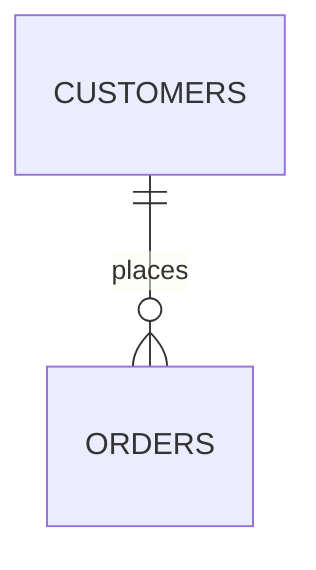
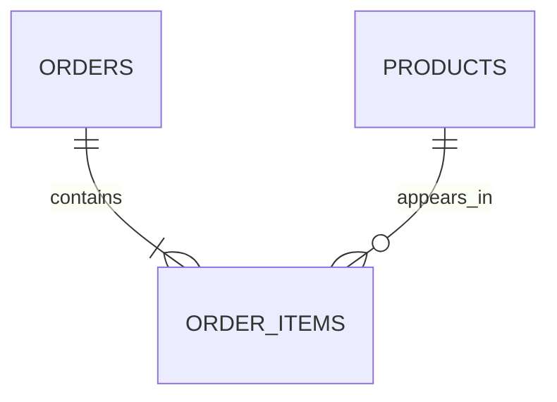

# درس ۶ — کلیدها و رابطه میان جدول‌ها

یکی از دلایل اصلی استفاده از دیتابیس رابطه‌ای این است که می‌توان اطلاعات مرتبط را در جدول‌های جداگانه نگهداری کرد و هنگام نیاز آن‌ها را به هم متصل کرد.

در این درس با کلید اصلی، کلید خارجی و الگوهای رایج رابطه آشنا می‌شویم.

## ۱. چرا به کلید نیاز داریم؟

فرض کنید جدول مشتریان فقط نام و شهر را داشته باشد. ممکن است دو نفر نام یکسان داشته باشند. اگر بخواهیم سفارش هر فرد را دقیق به خودش نسبت دهیم، نام به‌تنهایی شناسه مطمئنی نیست.

به همین دلیل برای هر مشتری یک شناسه پایدار تعریف می‌کنیم:

| customer_id | full_name | city |
|---:|---|---|
| 101 | سارا محمدی | تهران |
| 102 | سارا محمدی | اصفهان |
| 103 | آرمان رضایی | شیراز |

## ۲. Primary Key

**کلید اصلی (Primary Key)** یک ستون یا ترکیبی از چند ستون است که هر ردیف جدول را به‌صورت یکتا مشخص می‌کند.

ویژگی‌های کلید اصلی:
- مقدار تکراری ندارد.
- مقدار `NULL` نمی‌پذیرد.
- هر جدول فقط یک تعریف Primary Key دارد؛ اما این کلید می‌تواند از چند ستون تشکیل شود.

نمونه:

```sql
CREATE TABLE customers (
    customer_id BIGINT UNSIGNED AUTO_INCREMENT,
    full_name VARCHAR(120) NOT NULL,
    PRIMARY KEY (customer_id)
);
```

### کلید ترکیبی (Composite Key)

گاهی ترکیب دو ستون هویت یک رکورد را مشخص می‌کند. برای مثال، در جدول عضویت کاربران در رویدادها، هر کاربر نباید دوبار در یک رویداد ثبت‌نام کند:

```sql
CREATE TABLE event_user (
    user_id BIGINT UNSIGNED NOT NULL,
    event_id BIGINT UNSIGNED NOT NULL,
    registered_at DATETIME DEFAULT CURRENT_TIMESTAMP,
    PRIMARY KEY (user_id, event_id)
);
```

در اینجا هر ستون به تنهایی می‌تواند تکرار شود؛ اما ترکیب آن‌ها یکتا است.

## ۳. Foreign Key

**کلید خارجی (Foreign Key)** ستونی است که به یک کلید یکتا در جدول دیگری ارجاع می‌دهد. این محدودیت از ایجاد ارجاع نامعتبر جلوگیری می‌کند.

برای مثال هر سفارش به یک مشتری تعلق دارد:

```sql
CREATE TABLE orders (
    order_id BIGINT UNSIGNED AUTO_INCREMENT PRIMARY KEY,
    customer_id BIGINT UNSIGNED NOT NULL,
    order_date DATETIME NOT NULL,
    total_amount DECIMAL(12,2) NOT NULL,
    CONSTRAINT fk_orders_customer
        FOREIGN KEY (customer_id)
        REFERENCES customers(customer_id)
);
```

اکنون نمی‌توان سفارشی ثبت کرد که `customer_id` آن در جدول `customers` وجود نداشته باشد.

> نکته فنی: نوع، اندازه و علامت‌دار بودن ستون‌های مرتبط باید سازگار باشد. برای مثال `BIGINT UNSIGNED` باید به کلیدی با تعریف سازگار ارجاع دهد. در MySQL برای پشتیبانی از Foreign Key از InnoDB استفاده کنید.

## ۴. رفتار هنگام حذف یا تغییر رکورد والد

فرض کنید مشتری‌ای سفارش ثبت کرده است. اگر بخواهیم مشتری را حذف کنیم، با سفارش‌های وابسته چه کنیم؟

با گزینه‌های `ON DELETE` و `ON UPDATE` رفتار را مشخص می‌کنیم:

| گزینه | نتیجه |
|---|---|
| `RESTRICT` | تا وقتی رکورد وابسته وجود دارد، حذف/تغییر کلید والد مجاز نیست |
| `CASCADE` | تغییر کلید والد یا حذف آن به رکوردهای وابسته منتقل می‌شود |
| `SET NULL` | مقدار کلید خارجی در جدول فرزند NULL می‌شود؛ ستون باید NULLپذیر باشد |
| `NO ACTION` | در MySQL/InnoDB عملاً مانند RESTRICT بررسی می‌شود |

مثال:

```sql
CREATE TABLE orders (
    order_id BIGINT UNSIGNED AUTO_INCREMENT PRIMARY KEY,
    customer_id BIGINT UNSIGNED NOT NULL,
    order_date DATETIME NOT NULL,
    CONSTRAINT fk_orders_customer
        FOREIGN KEY (customer_id)
        REFERENCES customers(customer_id)
        ON DELETE RESTRICT
        ON UPDATE CASCADE
);
```

در این طراحی حذف مشتری‌ای که سفارش دارد رد می‌شود؛ اما اگر شناسه او تغییر کند، مقدار ارجاع در سفارش‌ها نیز به‌روزرسانی می‌شود.

برای رابطه‌هایی مانند «ثبت‌نام کاربر در رویداد»، ممکن است حذف ثبت‌نام‌های وابسته همراه با حذف رویداد یا کاربر منطقی باشد؛ در این حالت `CASCADE` می‌تواند انتخاب مناسبی باشد. تصمیم باید از قواعد کسب‌وکار بیاید.

## ۵. انواع رابطه میان جدول‌ها

### یک‌به‌چند (One-to-Many)

هر مشتری می‌تواند چند سفارش داشته باشد، اما هر سفارش متعلق به یک مشتری است.



کلید خارجی در سمت «چند» قرار می‌گیرد؛ یعنی در جدول `orders`.

### یک‌به‌یک (One-to-One)

برای مثال هر کاربر یک پروفایل تکمیلی دارد. کلید خارجی در جدول پروفایل قرار می‌گیرد و با `UNIQUE` تضمین می‌کنیم هر کاربر حداکثر یک پروفایل داشته باشد.

```sql
CREATE TABLE customer_profiles (
    profile_id BIGINT UNSIGNED AUTO_INCREMENT PRIMARY KEY,
    customer_id BIGINT UNSIGNED NOT NULL UNIQUE,
    birth_date DATE,
    CONSTRAINT fk_profile_customer
        FOREIGN KEY (customer_id)
        REFERENCES customers(customer_id)
);
```

### چندبه‌چند (Many-to-Many)

هر سفارش می‌تواند چند محصول داشته باشد و هر محصول نیز در سفارش‌های مختلف ظاهر شود. این رابطه را با یک جدول میانی پیاده‌سازی می‌کنیم.



جدول `order_items` علاوه بر دو کلید خارجی می‌تواند ویژگی‌های خود رابطه، مانند تعداد و قیمت زمان خرید را نگهداری کند:

```sql
CREATE TABLE order_items (
    order_item_id BIGINT UNSIGNED AUTO_INCREMENT PRIMARY KEY,
    order_id BIGINT UNSIGNED NOT NULL,
    product_id BIGINT UNSIGNED NOT NULL,
    quantity INT UNSIGNED NOT NULL,
    unit_price DECIMAL(12,2) NOT NULL,
    FOREIGN KEY (order_id) REFERENCES orders(order_id),
    FOREIGN KEY (product_id) REFERENCES products(product_id)
);
```

## ۶. چرا این طراحی برای تحلیل داده مهم است؟

ساختار رابطه‌ای کمک می‌کند هر واقعیت در جای مشخص خود ذخیره شود. برای نمونه:
- اطلاعات مشتری در `customers`
- مشخصات کالا در `products`
- زمان و وضعیت سفارش در `orders`
- تعداد و قیمت کالاهای هر سفارش در `order_items`

برای محاسبه فروش هر شهر، لازم است جدول سفارش را به مشتری متصل کنیم. برای تحلیل فروش محصول نیز باید جزئیات سفارش را به محصولات وصل کنیم. در جلسات JOIN این کار را با Query انجام می‌دهیم.

## تمرین عملی — کاربران و رویدادها

دو جدول `users` و `events` را طراحی کنید و سپس جدول میانی `event_user` را بسازید.

الزامات:
- `users.id` و `events.id` کلید اصلی افزایشی باشند.
- `event_user.user_id` به `users.id` ارجاع دهد.
- `event_user.event_id` به `events.id` ارجاع دهد.
- ترکیب `user_id` و `event_id` کلید اصلی ترکیبی باشد تا ثبت‌نام تکراری ممکن نباشد.
- هنگام حذف کاربر، ثبت‌نام‌های وابسته او نیز حذف شوند.
- هنگام حذف رویداد نیز رفتار حذف ثبت‌نام‌های وابسته را مشخص کنید.

## جمع‌بندی

- Primary Key هویت یکتای رکورد را مشخص می‌کند.
- Foreign Key رابطه و اعتبار ارجاع بین جدول‌ها را کنترل می‌کند.
- One-to-Many با یک Foreign Key در سمت چند پیاده‌سازی می‌شود.
- Many-to-Many معمولاً به جدول میانی نیاز دارد.
- انتخاب رفتار CASCADE یا RESTRICT باید بر اساس منطق کسب‌وکار انجام شود.

## مرجع

- [MySQL 8.4 — InnoDB and Foreign Keys](https://dev.mysql.com/doc/refman/8.4/en/innodb-foreign-key-constraints.html)
- [MySQL 8.4 — CREATE TABLE](https://dev.mysql.com/doc/refman/8.4/en/create-table.html)
