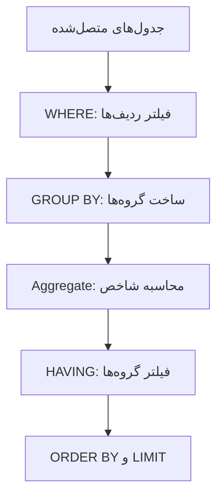

# درس ۳ — توابع تجمیعی، GROUP BY و HAVING

در گزارش‌گیری معمولاً به‌جای دیدن تک‌تک ردیف‌ها، یک شاخص خلاصه می‌خواهیم: درآمد کل، تعداد سفارش‌ها، میانگین مبلغ خرید یا فروش هر شهر. توابع تجمیعی (Aggregate Functions) برای همین کار ساخته شده‌اند.

## ۱. Aggregate Function چیست؟

تابع تجمیعی چند مقدار را بررسی می‌کند و یک نتیجه خلاصه برمی‌گرداند.

| تابع | کاربرد |
|---|---|
| `COUNT()` | شمارش ردیف‌ها یا مقادیر غیر NULL |
| `SUM()` | مجموع مقدارهای عددی |
| `AVG()` | میانگین مقادیر عددی |
| `MIN()` | کوچک‌ترین مقدار |
| `MAX()` | بزرگ‌ترین مقدار |
| `GROUP_CONCAT()` | تبدیل چند مقدار متنی به یک رشته |

مثلاً برای محاسبه مجموع، میانگین، کمینه و بیشینه قیمت کالاها:

```sql
SELECT
    COUNT(*) AS product_count,
    AVG(unit_price) AS average_price,
    MIN(unit_price) AS lowest_price,
    MAX(unit_price) AS highest_price
FROM products
WHERE active = TRUE;
```

اگر ستون عددی در بعضی ردیف‌ها NULL باشد، توابعی مانند SUM و AVG آن مقدارهای NULL را در محاسبه عددی وارد نمی‌کنند.

## ۲. تفاوت COUNT(*) و COUNT(column)

این دو کاربرد یکسانی ندارند:

- `COUNT(*)` تعداد ردیف‌های نتیجه را می‌شمارد.
- `COUNT(column)` فقط مقدارهای غیر NULL آن ستون را می‌شمارد.
- `COUNT(DISTINCT column)` تعداد مقدارهای یکتای غیر NULL را محاسبه می‌کند.

```sql
SELECT
    COUNT(*) AS all_rows,
    COUNT(city) AS rows_with_city,
    COUNT(DISTINCT city) AS distinct_cities
FROM customers;
```

این تفاوت هنگام بررسی کیفیت داده اهمیت زیادی دارد؛ تعداد کل رکوردها با تعداد رکوردهایی که یک ویژگی مشخص دارند الزاماً برابر نیست.

## ۳. محاسبه شاخص فروش در سطح کل فروشگاه

در دیتابیس تمرینی، مبلغ هر قلم سفارش از حاصل‌ضرب تعداد در قیمت ثبت‌شده هنگام خرید به دست می‌آید:

```sql
quantity * unit_price
```

پس درآمد فروش را از جدول `order_items` محاسبه می‌کنیم و برای کنار گذاشتن سفارش‌های لغوشده، آن را به `orders` متصل می‌کنیم:

```sql
SELECT
    COUNT(DISTINCT o.order_id) AS order_count,
    SUM(oi.quantity * oi.unit_price) AS revenue,
    SUM(oi.quantity) AS units_sold,
    AVG(oi.unit_price) AS average_unit_price
FROM orders AS o
JOIN order_items AS oi
    ON oi.order_id = o.order_id
WHERE o.status IN ('completed', 'shipped');
```

**نکته تحلیلی مهم:** بعد از اتصال Orders به Order Items، هر سفارش می‌تواند چند ردیف داشته باشد. بنابراین `COUNT(*)` تعداد اقلام سفارش را می‌شمارد، نه تعداد سفارش‌ها. برای شمارش سفارش‌ها باید از `COUNT(DISTINCT o.order_id)` استفاده کنیم.

## ۴. گروه‌بندی با GROUP BY

اگر شاخص را برای دسته‌های مختلف بخواهیم، از `GROUP BY` استفاده می‌کنیم. برای مثال درآمد هر شهر:

```sql
SELECT
    c.city,
    SUM(oi.quantity * oi.unit_price) AS revenue
FROM customers AS c
JOIN orders AS o
    ON o.customer_id = c.customer_id
JOIN order_items AS oi
    ON oi.order_id = o.order_id
WHERE o.status IN ('completed', 'shipped')
GROUP BY c.city
ORDER BY revenue DESC;
```

در این Query:
1. جدول مشتریان به سفارش‌ها متصل شده است.
2. جزئیات هر سفارش از Order Items اضافه شده است.
3. سفارش‌های لغوشده کنار گذاشته شده‌اند.
4. رکوردها بر اساس شهر گروه‌بندی شده‌اند.
5. مبلغ همه اقلام هر شهر جمع شده است.

### چند ستون در GROUP BY

می‌توان گروه‌ها را بر اساس ترکیب چند ویژگی ساخت. مثلاً فروش هر دسته محصول در هر شهر:

```sql
SELECT
    c.city,
    p.category,
    SUM(oi.quantity * oi.unit_price) AS revenue
FROM customers AS c
JOIN orders AS o
    ON o.customer_id = c.customer_id
JOIN order_items AS oi
    ON oi.order_id = o.order_id
JOIN products AS p
    ON p.product_id = oi.product_id
WHERE o.status IN ('completed', 'shipped')
GROUP BY c.city, p.category
ORDER BY c.city, revenue DESC;
```

هر ترکیب از شهر و دسته محصول یک گروه جداگانه می‌سازد.

## ۵. تفاوت WHERE و HAVING

این دو دستور هر دو فیلتر می‌کنند، اما در دو مرحله متفاوت:

- `WHERE` ردیف‌ها را پیش از گروه‌بندی حذف می‌کند.
- `HAVING` گروه‌ها را پس از محاسبه Aggregate فیلتر می‌کند.



مثال: فقط شهرهایی را ببینیم که درآمدشان بیش از ۵ میلیون است:

```sql
SELECT
    c.city,
    SUM(oi.quantity * oi.unit_price) AS revenue
FROM customers AS c
JOIN orders AS o
    ON o.customer_id = c.customer_id
JOIN order_items AS oi
    ON oi.order_id = o.order_id
WHERE o.status IN ('completed', 'shipped')
GROUP BY c.city
HAVING SUM(oi.quantity * oi.unit_price) > 5000000
ORDER BY revenue DESC;
```

شرط وضعیت سفارش یک شرط ردیفی است و در WHERE آمده؛ شرط درآمد کل شهر به نتیجه گروه وابسته است و در HAVING نوشته شده است.

## ۶. GROUP BY و DISTINCT

اگر فقط می‌خواهیم فهرست مقدارهای یکتای یک ستون را ببینیم، `DISTINCT` معمولاً ساده‌تر است:

```sql
SELECT DISTINCT city
FROM customers;
```

این Query از نظر کاربرد با گروه‌بندی ساده زیر مشابه است:

```sql
SELECT city
FROM customers
GROUP BY city;
```

اما وقتی قرار است برای هر گروه شاخصی مانند تعداد یا مجموع محاسبه کنیم، GROUP BY انتخاب طبیعی است.

## ۷. GROUP_CONCAT برای ساخت خلاصه متنی

در MySQL می‌توان مقدارهای متنی یک گروه را به یک رشته تبدیل کرد:

```sql
SELECT
    p.category,
    GROUP_CONCAT(
        DISTINCT p.product_name
        ORDER BY p.product_name
        SEPARATOR ' | '
    ) AS products
FROM products AS p
GROUP BY p.category;
```

این تابع برای ساخت خلاصه یا برچسب‌های گروهی مفید است؛ اما خروجی آن جایگزین جدول رابطه‌ای نیست. همچنین طول نتیجه GROUP_CONCAT محدود است و با تنظیم `group_concat_max_len` کنترل می‌شود.

## ۸. یک قاعده مهم در MySQL: ONLY_FULL_GROUP_BY

در Query گروه‌بندی‌شده، هر ستون عادی که در SELECT نمایش داده می‌شود باید در GROUP BY باشد یا از نظر قواعد دیتابیس به ستون‌های گروه‌بندی‌شده وابستگی تابعی داشته باشد؛ در غیر این صورت MySQL در حالت SQL Mode متداول `ONLY_FULL_GROUP_BY` خطا می‌دهد.

مثال درست:

```sql
SELECT city, COUNT(*) AS customer_count
FROM customers
GROUP BY city;
```

از انتخاب ستون‌هایی که نه در گروه‌بندی هستند و نه Aggregate شده‌اند پرهیز کنید؛ در غیر این صورت ممکن است مقدار نامشخصی از گروه دریافت کنید.

## تمرین

1. تعداد مشتریان هر شهر را محاسبه کنید.
2. تعداد سفارش‌های هر وضعیت را به دست آورید.
3. درآمد هر دسته محصول را محاسبه کنید.
4. شهرهایی را نمایش دهید که بیش از یک سفارش تکمیل‌شده دارند.
5. تعداد مشتریان یکتا در میان سفارش‌ها را محاسبه کنید.

## چالش تحلیلی

مدیر می‌خواهد عملکرد هر شهر را با سه شاخص مقایسه کند: تعداد سفارش، تعداد واحد کالای فروخته‌شده و درآمد. Query را طوری طراحی کنید که:
- سفارش‌های لغوشده در محاسبات نباشند.
- تعداد سفارش‌ها به دلیل چندردیفی شدن Order Items اشتباه شمرده نشود.
- شهرها از بیشترین درآمد به کمترین درآمد مرتب شوند.

## جمع‌بندی

Aggregateها شاخص‌های خلاصه می‌سازند؛ GROUP BY داده را به گروه تبدیل می‌کند و HAVING روی نتیجه گروه‌ها شرط می‌گذارد. مهم‌ترین نکته تحلیلی این درس، شناخت سطح هر ردیف (Grain) پس از JOIN است تا شمارش و جمع اشتباه نشود.

## مطالعه بیشتر

- [MySQL 8.4 — Aggregate Functions](https://dev.mysql.com/doc/refman/8.4/en/aggregate-functions.html)
- [MySQL 8.4 — GROUP BY Handling](https://dev.mysql.com/doc/refman/8.4/en/group-by-handling.html)
