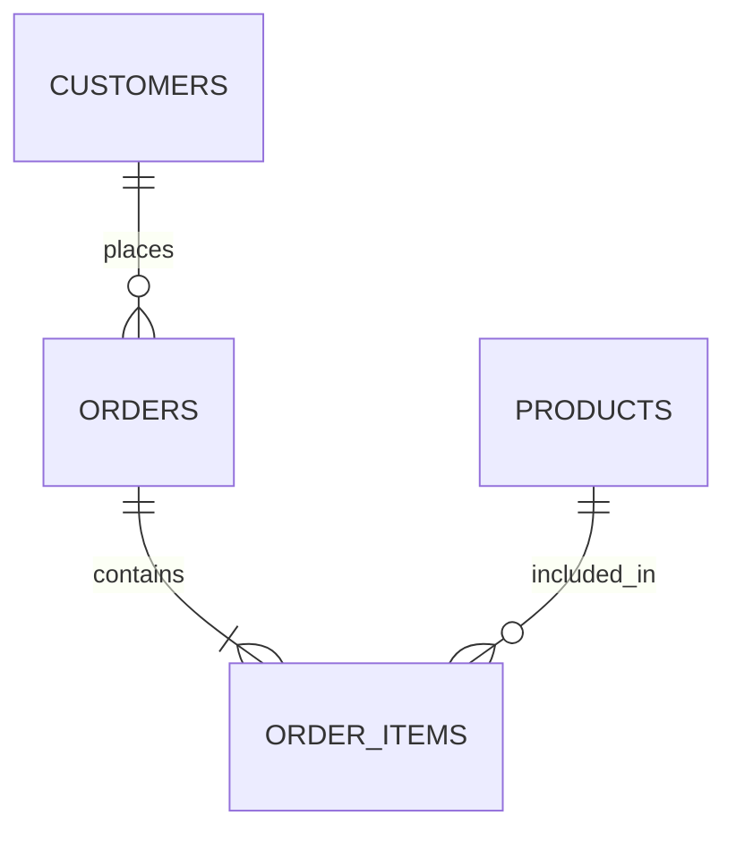

# درس ۵ — آزمایشگاه تحلیل داده با SQL

در این آزمایشگاه از دیتابیس فروشگاه بوت‌کمپ استفاده می‌کنیم. هدف تمرین حفظ کردن Syntax نیست؛ باید سؤال را به سطح داده، جدول‌های لازم و Query مناسب تبدیل کنید.

پیش از شروع، مطمئن شوید فایل [retail_schema.sql](../practice/retail_schema.sql) را اجرا کرده‌اید.

## نقشه دیتابیس

## بخش اول — شناخت داده

| شماره | سؤال | ابزارهای مورد انتظار |
|---|---|---|
| ۱ | تمام شهرهای ثبت‌شده در جدول مشتریان را بدون تکرار نمایش دهید. | SELECT، DISTINCT |
| ۲ | سفارش‌های ثبت‌شده در بازه اول آوریل تا پایان آوریل ۲۰۲۵ را پیدا کنید. | WHERE، بازه تاریخ |
| ۳ | کالاهای فعال را از گران‌ترین به ارزان‌ترین مرتب کنید. | WHERE، ORDER BY |
| ۴ | پنج ردیف اول جدول اقلام سفارش را مشاهده کنید. | LIMIT |

## بخش دوم — شاخص‌های خلاصه

| شماره | سؤال | ابزارهای مورد انتظار |
|---|---|---|
| ۵ | تعداد کل مشتریان و تعداد شهرهای یکتا را محاسبه کنید. | COUNT، DISTINCT |
| ۶ | تعداد واحدهای فروخته‌شده از هر محصول را به دست آورید. | SUM، GROUP BY |
| ۷ | درآمد هر دسته محصول را محاسبه کنید. | SUM، JOIN، GROUP BY |
| ۸ | شهرهایی را نمایش دهید که درآمد فروش آن‌ها از یک آستانه مشخص بیشتر است. | HAVING |

## بخش سوم — بررسی رفتار مشتری

| شماره | سؤال | ابزارهای مورد انتظار |
|---|---|---|
| ۹ | مشتریانی را پیدا کنید که حداقل یک سفارش تکمیل‌شده دارند. | EXISTS یا IN |
| ۱۰ | مشتریانی را پیدا کنید که هنوز هیچ سفارشی ثبت نکرده‌اند. | NOT EXISTS |
| ۱۱ | درآمد هر مشتری را محاسبه و مشتریان را از بیشترین درآمد مرتب کنید. | JOIN، SUM، GROUP BY |
| ۱۲ | محصولاتی را پیدا کنید که در هیچ قلم سفارشی دیده نشده‌اند. | NOT EXISTS یا LEFT JOIN |

## بخش چهارم — ساخت گزارش مدیریتی

مدیر فروش یک گزارش خلاصه می‌خواهد که برای هر شهر شامل موارد زیر باشد:
- تعداد مشتریان
- تعداد سفارش‌های تکمیل‌شده یا ارسال‌شده
- تعداد واحد کالای فروخته‌شده
- درآمد کل

**نکته:** پس از JOIN به جدول `order_items`، هر سفارش ممکن است چند ردیف داشته باشد. برای شمارش سفارش از `COUNT(DISTINCT order_id)` استفاده کنید تا تعداد اقلام با تعداد سفارش اشتباه نشود.

## بخش پنجم — کنترل کیفیت Query

قبل از نهایی کردن هر Query این سؤال‌ها را از خودتان بپرسید:

- آیا سطح هر ردیف خروجی را می‌دانم؟ مشتری، سفارش، قلم سفارش یا محصول؟
- آیا JOIN باعث چندبرابر شدن رکوردها شده است؟
- آیا ردیف‌های لغوشده باید در شاخص فروش باشند؟
- آیا NULLها به درستی مدیریت شده‌اند؟
- آیا عنوان شاخص‌ها دقیق و قابل فهم است؟
- آیا با یک Query کنترلی می‌توانم عدد نهایی را راستی‌آزمایی کنم؟

## خروجی مورد انتظار

یک فایل با نام `retail_analysis.sql` بسازید و Queryهای تمرین را همراه با کامنت و عنوان هر سؤال در آن قرار دهید. برای هر سؤال، نام ستون خروجی را معنادار انتخاب کنید.

## معیار ارزیابی

| معیار | انتظار |
|---|---|
| صحت Query | خروجی با تعریف سؤال منطبق باشد |
| دقت تحلیلی | Grain و سطح محاسبه درست باشد |
| کیفیت اتصال | شرط JOIN صحیح باشد و Duplicate ناخواسته ایجاد نشود |
| خوانایی | Alias و نام ستون‌ها معنادار باشند |
| تفسیر | بتوانید نتیجه را به زبان کسب‌وکار توضیح دهید |

> تحلیل خوب فقط اجرای یک دستور نیست؛ باید بتوانید توضیح دهید عددی که گزارش می‌کنید دقیقاً چه چیزی را می‌سنجد.
