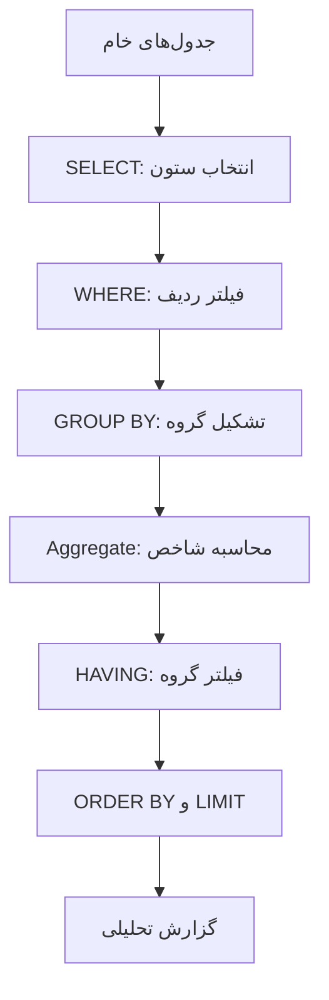

# ماژول ۲ — کار با داده‌ها و پرس‌وجوهای تحلیلی

در این ماژول از ساختار پایگاه داده عبور می‌کنیم و روی خود داده‌ها کار می‌کنیم: داده را می‌خوانیم، شرط می‌گذاریم، مرتب می‌کنیم، خلاصه می‌کنیم و در صورت نیاز با احتیاط تغییر می‌دهیم.

**سناریوی مشترک:** فروشگاه آنلاین بوت‌کمپ. همه مثال‌ها از جدول‌های `customers`، `products`، `orders` و `order_items` استفاده می‌کنند. اگر هنوز دیتابیس تمرینی را نساخته‌اید، ابتدا [راهنمای SQL](../README.md) را ببینید و فایل [retail_schema.sql](../practice/retail_schema.sql) را اجرا کنید.

## مسیر درس‌ها

| درس | عنوان | خروجی |
|---|---|---|
| [۱](./01-select-filter-sort-limit.md) | خواندن، فیلتر و مرتب‌سازی داده | ساخت خروجی دقیق با SELECT، WHERE، ORDER BY و LIMIT |
| [۲](./02-insert-update-delete.md) | درج و تغییر داده | کار با INSERT، UPDATE و DELETE با رعایت ایمنی |
| [۳](./03-aggregate-group-having.md) | خلاصه‌سازی و گروه‌بندی | محاسبه KPI با Aggregate، GROUP BY و HAVING |
| [۴](./04-subqueries-and-exists.md) | پرس‌وجوهای تو‌در‌تو | حل مسئله‌های چندمرحله‌ای با Subquery و EXISTS |
| [۵](./05-analysis-practice-lab.md) | آزمایشگاه تحلیل داده | تمرین مستقل روی داده فروشگاه |

## نقشه مفهومی

## نکته مهم درباره تغییر داده‌ها

در کار تحلیل داده، بیشتر زمان ما صرف خواندن و تبدیل داده می‌شود، نه تغییر مستقیم جداول عملیاتی. دستورهای INSERT، UPDATE و DELETE را برای شناخت چرخه داده و کار با جدول‌های آزمایشی یاد می‌گیریم. روی دیتابیس واقعی سازمان بدون مجوز، نسخه پشتیبان و برنامه بازگشت، داده‌ای را تغییر یا حذف نکنید.

## پیش‌نیاز و فایل تمرینی

- ماژول [مبانی Database و MySQL](../01-database-foundations/README.md)
- [دیتابیس تمرینی فروشگاه](../practice/retail_schema.sql)
