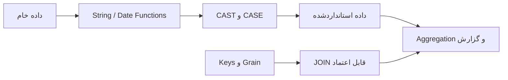

# ماژول ۳ — تبدیل داده و مفاهیم طراحی برای تحلیلگر

در این ماژول یاد می‌گیریم چطور با توابع داخلی MySQL متن، عدد و تاریخ را برای تحلیل آماده کنیم. در پایان، چند مفهوم طراحی دیتابیس را هم مرور می‌کنیم که دانستن آن‌ها برای تشخیص رکورد تکراری، تعیین سطح داده و نوشتن JOIN مطمئن ضروری است.

## درس‌های ماژول

| درس | عنوان | کاربرد |
|---|---|---|
| [۱](./01-mysql-functions.md) | توابع کاربردی MySQL | پاک‌سازی متن، محاسبات عددی، استخراج اجزای تاریخ و مدیریت NULL |
| [۲](./02-case-cast-and-date-conversion.md) | CASE، CAST و تبدیل تاریخ | دسته‌بندی داده‌ها و تبدیل نوع داده برای گزارش |
| [۳](./03-keys-grain-and-functional-dependencies.md) | کلید، Grain و وابستگی تابعی | تشخیص یکتایی، رابطه میان ستون‌ها و کنترل کیفیت JOIN |

## ارتباط این ماژول با تحلیل داده

## محیط آموزشی

مثال‌ها برای MySQL 8.4 نوشته شده‌اند. توابع رشته، تاریخ و تبدیل نوع داده در DBMSهای دیگر ممکن است Syntax متفاوتی داشته باشند.

## فایل‌های مرتبط

- [راهنمای SQL](../README.md)
- [دیتابیس تمرینی فروشگاه](../practice/retail_schema.sql)
- [ماژول کار با داده‌ها](../02-data-operations-and-analysis/README.md)
