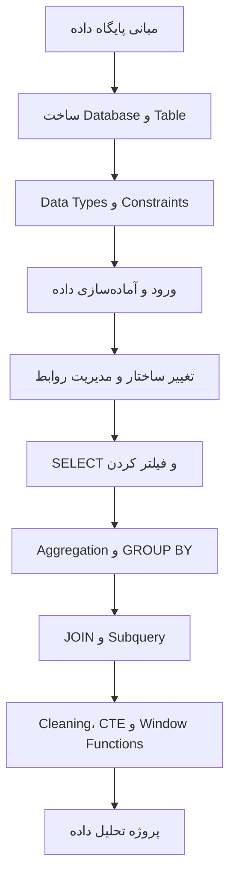
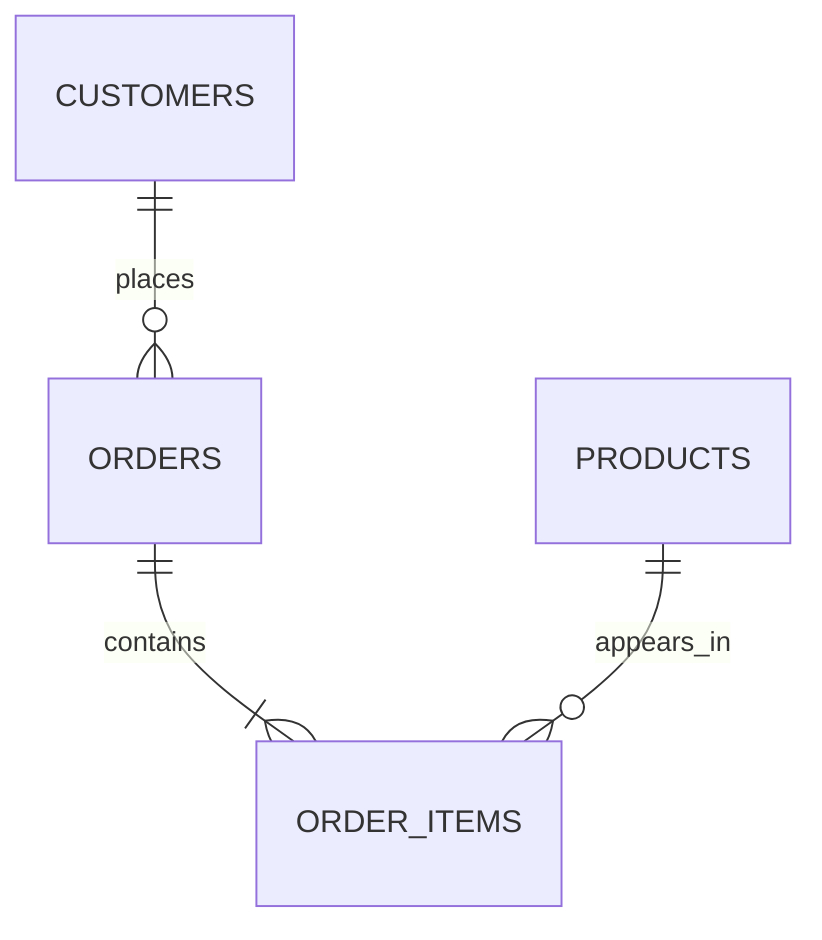

# SQL و پایگاه داده | مسیر یادگیری بوت‌کمپ تحلیل داده

این بخش برای یادگیری SQL با رویکرد **تحلیل داده و پاسخ‌گویی به سؤال‌های کسب‌وکار** طراحی شده است. در این مسیر ابتدا ساختار پایگاه داده را می‌شناسیم، سپس با MySQL کار می‌کنیم و بعد از آن سراغ Queryنویسی و تحلیل می‌رویم.

> هدف این نیست که فقط دستورها را حفظ کنیم؛ هدف این است که بدانیم داده‌ها کجا و چگونه ذخیره شده‌اند، چطور به شکل درست به آن‌ها دسترسی پیدا کنیم و چطور از آن‌ها پاسخ قابل اتکا استخراج کنیم.

## نقشه راه

## ماژول آغازین — مبانی و طراحی پایگاه داده

| درس | عنوان | خروجی یادگیری |
|---|---|---|
| 01 | Database، DBMS و مدل‌های داده | تشخیص نقش پایگاه داده، DBMS و SQL و شناخت مدل رابطه‌ای |
| 02 | اتصال به MySQL و مدیریت Database | ساخت، انتخاب، مشاهده و حذف ایمن Database |
| 03 | ساخت Table و انتخاب Data Type | طراحی جدول با نوع داده و محدودیت مناسب |
| 04 | ورود داده از CSV و SQL | بارگذاری داده و کنترل کیفیت اولیه پس از Import |
| 05 | تغییر ساختار جدول با ALTER TABLE | توسعه یا اصلاح Schema بدون ساخت مجدد جدول |
| 06 | Primary Key، Foreign Key و Relationships | طراحی رابطه‌های یک‌به‌چند و چندبه‌چند |

## ماژول‌های آموزشی

| مرحله | ماژول | محتوای اصلی |
|---|---|---|
| ۱ | [مبانی پایگاه داده](./01-database-foundations/README.md) | Database، MySQL، طراحی جدول، Data Type، Import و کلیدها |
| ۲ | [کار با داده‌ها و Queryنویسی](./02-data-operations-and-analysis/README.md) | SELECT، فیلتر، مرتب‌سازی، DML، Aggregate، GROUP BY و Subquery |
| ۳ | [تبدیل داده و طراحی](./03-data-transformation-and-design/README.md) | توابع MySQL، CASE، CAST، Grain و Functional Dependency |
| ۴ | [اتصال و تحلیل پیشرفته](./lesson-notes.md) | JOIN، CTE، Window Functions، روند زمانی و پروژه پایانی |

## فایل‌ها و تمرین‌های اصلی

- [دیتابیس تمرینی فروشگاه](./practice/retail_schema.sql)
- [فایل نمونه CSV مشتریان](./practice/customers_sample.csv)
- [درس‌نامه‌های تکمیلی SQL](./lesson-notes.md)

**ترتیب پیشنهادی:** ماژول ۱ ← ماژول ۲ ← ماژول ۳ ← اتصال و تحلیل پیشرفته.

## محیط و نسخه آموزشی

مثال‌های این بخش بر اساس **MySQL 8.4** نوشته شده‌اند. ممکن است نام گزینه‌ها یا برخی قابلیت‌ها در ابزارهایی مانند MySQL Workbench و DataGrip کمی متفاوت باشد؛ خود Queryها را در MySQL اجرا می‌کنیم.

برای اجرای مثال‌ها به یک MySQL Server و یک Client نیاز دارید. می‌توانید از محیط گرافیکی مانند DataGrip یا MySQL Workbench استفاده کنید یا از خط فرمان MySQL کمک بگیرید.

## دیتاست تمرینی مشترک

در درس‌ها از یک سناریوی فروشگاه آنلاین استفاده می‌کنیم. فایل [retail_schema.sql](./practice/retail_schema.sql) دیتابیس تمرینی، جدول‌ها و چند رکورد نمونه را می‌سازد. بهتر است آن را یک‌بار در محیط MySQL خود اجرا کنید تا در درس‌های بعدی بتوانیم از همان جدول‌ها استفاده کنیم.

ساختار کلی داده:

- هر مشتری می‌تواند چند سفارش داشته باشد.
- هر سفارش می‌تواند چند قلم کالا داشته باشد.
- هر کالا می‌تواند در سفارش‌های مختلف تکرار شود.
- جدول `order_items` جزئیات هر سفارش را نگه می‌دارد و رابطه چندبه‌چند میان سفارش و کالا را پیاده‌سازی می‌کند.

## شیوه مطالعه

1. ابتدا توضیح و نمودار هر درس را بخوانید.
2. Queryها را در MySQL اجرا کنید؛ فقط به خواندن کد اکتفا نکنید.
3. خروجی را با توضیح درس مقایسه کنید.
4. تمرین را بدون نگاه کردن به راه‌حل انجام دهید.
5. اگر در کلاس حضور نداشتید، مثال‌ها و فایل تمرینی را به ترتیب اجرا کنید.

## منابع مرجع

- [MySQL 8.4 Reference Manual](https://dev.mysql.com/doc/refman/8.4/en/)
- [MySQL Data Types](https://dev.mysql.com/doc/refman/8.4/en/data-types.html)
- [MySQL Character Sets and Collations](https://dev.mysql.com/doc/refman/8.4/en/charset.html)
- [MySQL Storage Engines](https://dev.mysql.com/doc/refman/8.4/en/storage-engines.html)
